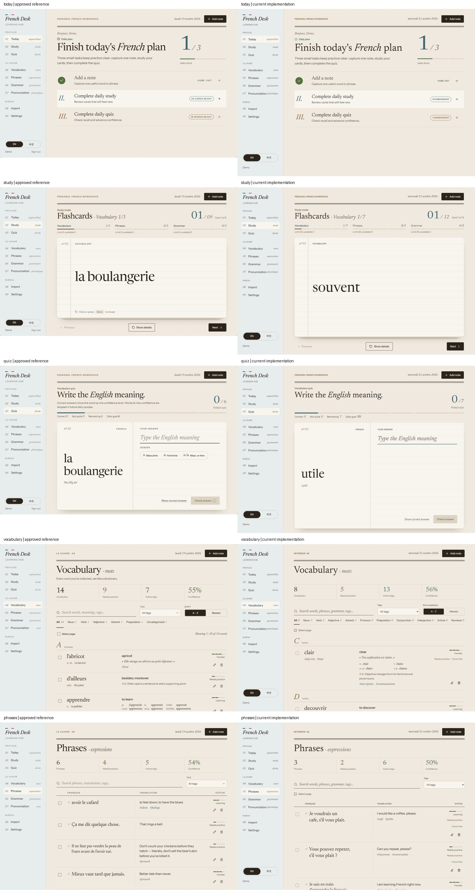
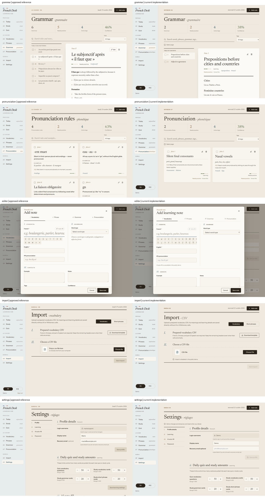
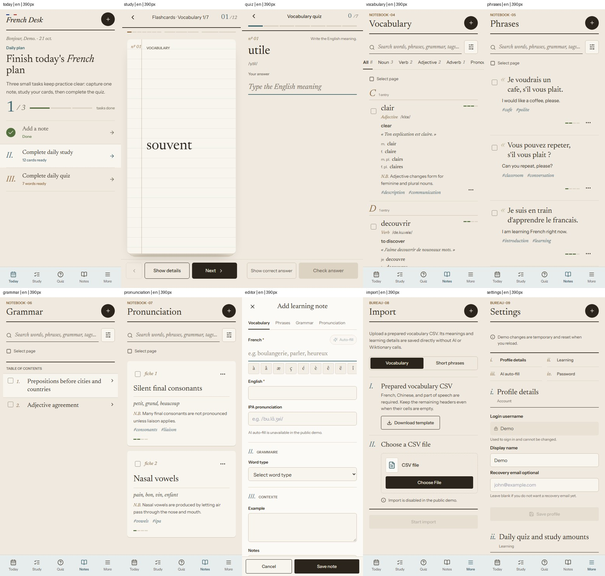
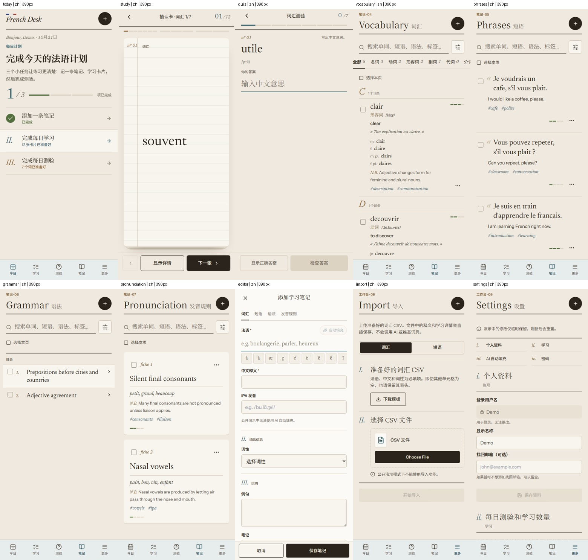

# UI 2.0 Final Audit

Current cleanup baseline: `2e9f111` on `UI_2.0`, after approved Authentication/Setup PR #26. [Auth/Setup evidence and verification](docs/ui2-auth.md) close the former UI7-08 design gap; the latest implementation record reports 114 Node tests and 162 serial Chromium cases passing. The [test review](UI2_TEST_REVIEW.md) retains the CI follow-up and acceptance limits.

The Phase 7 audit below is historical: baseline `ef8597e1a07441fc06baa4dfd38239e761ec721c` (PR #24), implementation branch `codex/ui2-final-audit`. Its measurements and run counts describe that revision, not a new production certification. Scope: design-compatible polish, accessibility, measured loading improvements, proven dead paths and documentation. No production operations or learning/data-layer redesign.

## Prioritized Audit Before Implementation

The original baseline captures and per-viewport diagnostics are recoverable from Git revision `2e9f111`; representative comparisons remain below. The audit opened every feature, login/signup and the editor in EN/ZH at 320, 370, 390, 768 and 1280 CSS pixels: 110 combinations, no measured horizontal document overflow, unnamed visible form controls or console/page errors. This is not a claim of complete accessibility compliance.

| ID | Priority | Evidence / affected files | Impact | Proposed action |
| --- | --- | --- | --- | --- |
| UI7-01 | P1 | Editor has a Tab trap and body lock, but its workspace siblings remain non-inert (`src/components/EditorModal.jsx` focus effect; runtime reproduction to accompany fix). | Assistive technology and programmatic focus can reach background navigation while the modal is open. | Add reversible sibling inertness inside the existing focus lifecycle, restore before trigger focus, preserve async/editor ownership logic. |
| UI7-02 | P2 | Baseline Chinese snapshots retain `htmlLang: en`, although the workspace is `zh-CN`; login has no nested workspace language (`LanguageContext.jsx`, `index.html`). | Incorrect screen-reader pronunciation and document-language metadata. | Synchronize the document language with the displayed context; no preference/network lifecycle changes. |
| UI7-03 | P2 | Login mode buttons have no selected state and failure text is not an alert (`SignInPage.jsx`). | Selection and failed submission are less discoverable without sight. | Add pressed/busy/error semantics and autocomplete without changing Auth calls or inventing a new login design. |
| UI7-04 | P2 | `build-before.json`: initial JS 784,795 bytes / 228,141 gzip; all feature views/editor eagerly imported in `App.jsx`. Required React, Supabase and parse5 are the largest foundation modules. | Downloads/rendering code for unopened secondary views on the first visit. | Trial feature-level lazy loading with a scoped recoverable error surface; retain only if measured improvement is meaningful. Do not split vendors merely to hide warnings or change sanitization/Auth. |
| UI7-05 | P2 | Three local TTF assets total 1,141,684 bytes (`public/fonts`, preload and font-face declarations). | Avoidable cold font transfers. | Evaluate lossless full-character WOFF2 conversion; compare cmap, variations and French glyphs, preserve both OFL licenses and Chinese fallbacks. Prefer full coverage over aggressive subsetting. |
| UI7-06 | P2 | `account-lifecycle.spec.js` combines a private mock backend and 112 generated scenarios including five feature-page tests. | Harder to locate UI tests and reuse the proven synthetic-account fixture. | Move the fixture and the five Bureau cases mechanically, preserving every test body/name and ownership assertion. Do not target a smaller arbitrary test count. |
| UI7-07 | P3 | Repository-wide source search finds no callers of TodayPanel, PracticeQueue, FrenchInTheWild or Metric; old flip/soft-panel/numeric CSS is not used by the current Study UI. App computes unused stats/weakItems props. | Unreachable legacy maintenance surface and unnecessary per-notes aggregation. | Delete only proven zero-caller components/rules/props; leave compatibility aliases still used by Auth/setup and active feature styles. |
| UI7-08 | P2, design gap | Fresh login/signup screenshots retain the prior navy icon, blue input borders and marketing composition. No approved authentication frame exists in the supplied design directory. | The public entry surface is not fully Le Cahier. | Document a follow-up requiring an approved authentication reference; do not invent a redesign. |
| UI7-09 | P2 | README describes the demo/local path, persistence scope, recovery and E2E inventory imprecisely. Historical AUDIT.md predates the reliability/UI work. | Reviewers can infer unsupported cross-device recovery or outdated risks. | Update current README and add an explicit historical-audit status note; retain technical contracts and all approved source artifacts. |
| UI7-10 | P2, supplementary inspection | The missing-configuration Setup page has a 544px intrinsic grid item at 320/370/390px, caused by its unbroken environment example (`src/pages/SetupPage.jsx`). | A new visitor without configuration gets horizontal document overflow. | Constrain the existing grid child with `min-width: 0`; retain the example's own horizontal scrolling. No authentication redesign. |

## Implementation And Preservation

UI7-01/02/03: the existing editor focus lifecycle now makes workspace siblings inert and restores their previous inert state before returning focus. The document language follows EN/ZH. Auth mode selection, autocomplete, loading and error feedback gain semantics without changing Auth requests or its existing loading-screen behavior. No visual redesign.

UI7-04/05: eight secondary views load on demand, with a view-scoped loading status and an error boundary offering explicit reload. Navigation and the shell survive a failed module. Today/editor remain eager; import jobs and all persistence hooks retain their original ownership in App. Local TTFs become full-coverage WOFF2, retaining glyph order, character maps, variable axes, French ligatures/accents and both OFL licenses. No Chinese-font or sanitizer replacement, aggressive subsetting, vendor-chunk trick or new project dependency.

UI7-06/07: the shared synthetic-account fixture and five Bureau tests were extracted mechanically. Four zero-consumer legacy components (TodayPanel, PracticeQueue, FrenchInTheWild, Metric), their unused App aggregates/props, and obsolete `soft-panel`, `numeric`, `flip-*` CSS were removed after repository reference searches. All six active stylesheets were reviewed; no speculative purge of dynamic classes. Auth/setup compatibility aliases and the active `study-*`, `quiz-*`, `library-*`, `editor-*`, `bureau-*` rules remain. Their scoped styles already share the root tokens; no new component/token framework is warranted.

UI7-09/10: README now explains actual Demo, local/cloud persistence, recovery, language and test boundaries. Setup's intrinsically oversized grid child is constrained rather than redesigned. Historical audit findings remain traceable, with a current-status pointer; current technical contracts and approved design artifacts are retained. No other plan was confirmed safe to delete merely because it predates this phase.

Protected paths have no changes: `api/`, `src/api/`, `src/hooks/`, `src/utils/`, `src/services/`, `supabase/`, package manifests, build/deployment configuration and the approved reference directory. App changes are limited to view loading, dead props and feedback semantics; Editor changes only affect background isolation. No production operation, paid AI call, schema change or learning-logic rewrite.

## Visual And Accessibility Review

The source-left/current-right overviews below use Phase 7 captures of the approved HTML and implementation at 1280px. They are review contact sheets, not a claim of pixel parity with static sample data. Source desktop frames can be shorter than the 900px app viewport; images are proportionately reduced only for these overview sheets. Redundant individual captures were consolidated during cleanup; the complete historical set remains in Git revision `2e9f111`. Later Auth/Setup comparisons are linked separately.

| Step | Surface / current health | Evidence and decisions |
| --- | --- | --- |
| 1 | Login / signup: approved design implemented after Phase 7 | [Auth comparisons](docs/ui2-auth.md#visual-evidence) cover desktop/mobile, EN/ZH, validation and connection recovery. Submission is now inline without discarding the draft. |
| 2 | Setup: approved design implemented, width constraint retained | [Desktop](docs/ui2-auth/comparison/setup-desktop.png) and [Chinese mobile](docs/ui2-auth/comparison/setup-mobile.png). The environment example scrolls within its own block rather than widening the document. |
| 3 | Today / shell: consistent | Three real goals, notebook typography, compact navigation. Desktop sidebar, tablet rail, mobile sheets, keyboard dismissal and selected state checked. |
| 4 | Study: consistent | Paper/stack, category ledger, hidden faces/inertness, reveal/return, confidence controls, long-content internal scroll, swipe/keyboard and reduced motion retained. Random word/count differs from prototype fixtures, intentionally. |
| 5 | Quiz: consistent | Writing line, noun-gender controls, answer feedback/retry, completion, large queue ledger and focused mobile layout. No scoring or confidence-rule changes. |
| 6 | Vocabulary: consistent | Compact mobile first entry, type filters, sort, search, tags, selection/actions and pagination. Real enum categories/counts exceed the static reference sample and remain available. |
| 7 | Phrases: consistent | French/translation rows, long text, contextual tags, selection and retained pagination/actions. |
| 8 | Grammar: consistent | Contents rail and journal reader, rich content, filtering and confirmation behavior. Existing safe content is not rewritten to match the prototype's example. |
| 9 | Pronunciation: consistent | Fiche grid and phone stack, example/note hierarchy, confidence and compact actions. |
| 10 | Editor: isolation fixed, appearance preserved | Full-screen phone/scrolling desktop form and persistent footer, field/morphology controls, formatting toolbar, validation/pending/failed/retry states retained. New focus isolation is intentionally nonvisual. |
| 11 | Import / Settings: consistent | Editorial steps, native picker, actual batch recovery/counts, independent section forms and entitlement. Demo disables real operations; synthetic authenticated tests cover editable states. |

- Baseline main-page probe: **110 combinations**. Final probe: **120 combinations**, adding signup at every width. EN/ZH at 320, 370, 390, 768 and 1280px; no horizontal document overflow, unnamed visible native controls or console/page errors in those checked states. Setup is separately checked at ten combinations, including its newly discovered/fixed overflow; do not infer that it passed the initial 110-case baseline.
- Raw before/after runtime and supplementary Setup checks are recoverable at Git revision `2e9f111`; their measured outcomes are summarized here rather than retaining every viewport dump.
- Historical pixel comparison: 38 of 46 common initial screenshots were pixel-identical; four Study screenshots differed in the randomized word and four others had only 13-44 changed raster pixels each. All common image dimensions matched. This supports no intentional Phase 7 redesign, not global screenshot-test coverage. The original comparison report is recoverable at the same Git revision.
- Core ink/paper contrast is 12.72:1; secondary text 7.70:1; muted text 4.69:1; river/wood/sage text at least 4.61:1 on paper (all higher on sheet). These sampled opaque token pairs pass 4.5:1; disabled/alpha/native/error combinations are not universally certified by this measurement.
- Visible focus, native dialogs, labelled controls, current/pressed/checked state, live feedback and boolean flashcard inertness were inspected alongside the existing interaction tests. Editor siblings now resist programmatic focus and are restored on repeated close/reopen. Reduced-motion rules in all six stylesheets remain. Phone primary controls are approximately 44px or larger; compact character/format controls are 36/40px and meet the 24px minimum, not a blanket 44px claim.
- Chromium reduced visual-viewport tests exercise focused fields and footer reachability; real OS keyboards, touch assistive technology and screen-reader pronunciation remain manual acceptance. The in-app Demo was also visually inspected, not just the CLI captures.

## Measured Loading Results

Local production preview, fresh Chromium contexts, three cold samples each at 390 and 1280px; reduced motion, settled local fonts. Existing Google font CSS was intercepted to an empty stylesheet and external requests blocked, so Chinese used system fallback. These are controlled local payload/layout checks, not field performance, network-throttled mobile benchmarks or Lighthouse scores.

| Metric | Baseline | Final | Interpretation |
| --- | ---: | ---: | --- |
| Initial minified JS | 784.80 kB | 705.98 kB | About 10% less initial code; secondary views no longer eager. |
| Cold initial JS, gzip | 228,141 B | 207,395 B | 9.09% less initial transfer. |
| Local font files / cold font bytes | 1,141,684 B | 543,988 B | 52.35% reduction, original coverage retained. |
| CSS, minified | 115.10 kB | 113.36 kB | Small proven dead-style/Tailwind-output reduction; all feature CSS remains eager. |
| CLS, 390px | 0.00193 | 0.00193 | No measured regression in the controlled Today probe. |
| CLS, 1280px | 0.01682 | 0.01682 | No measured regression; font swap still occurs. |

Evidence: [build before](docs/ui2-final/build-before.json), [build after](docs/ui2-final/build-after.json), [cold runs before](docs/ui2-final/performance-before.json), [cold runs after](docs/ui2-final/performance-after.json), [font coverage](docs/ui2-final/font-conversion.json). Baseline module report was sampled in Vite's bundle hook (CSS can differ by a few finalization bytes); final report reads emitted files. Transfer measurements are from actual preview responses. Local DOM-ready timings are descriptive only; no >50ms long task was observed in these six final probes.

The >500kB warning **remains**. React DOM, Supabase and parse5 are required initial foundations, not dead features. Moving protected Auth or sanitization merely to suppress a warning is out of scope. All-view JS sum can increase slightly through chunk wrappers/shared helpers; initial savings are not a claim of smaller total application code. Eighteen EN/ZH production-view navigations confirm emitted chunks resolve with no console/page errors. The failed-module regression separately verifies actionable feedback and navigation survival.

## Historical Audit Reassessment

| Findings | Current UI_2.0 disposition |
| --- | --- |
| FD-01 through FD-16, FD-25 | Previously implemented reliability/security contracts are present in current hooks/APIs and targeted tests. Retained without rewriting; this audit does not independently certify deployed DB policies or multi-device guarantees. |
| FD-17 | Current Study already uses boolean inertness/hidden faces and focus-aware flip behavior; its keyboard/hidden-face regression remains. Old empty-string-inert reproduction is obsolete. |
| FD-18 | Current controls/navigation/library feedback already have labels/state semantics and native dialogs. This task closes the remaining editor-background, document-language and Auth-feedback omissions. Manual AT/device acceptance remains separate. |
| FD-19 | Primary UI/action/pagination feedback is bilingual. French editorial glosses are intentional. Freeform backend/Auth error text and previously saved meanings are not completely localized; changing UI language does not translate content. Remaining limitation, not justification to rewrite user notes. |
| FD-20 | Current mobile libraries hide secondary metrics and expose the first note/filter quickly; old stacked-metric reproduction no longer applies. |
| FD-21 | Current 114 Node tests plus authenticated/mock regression suites cover the former omitted failure contracts. See the test review rather than treating old Demo-only evidence as current. |
| FD-22 | Current unit-file enumeration is complete. CI artifact upload remains an optional diagnostics gap; no workflow/deployment change here. Physical-device/cross-engine checks remain a separate gate. |
| FD-23 | Confirmed dead components, props and flip styles removed. Global dishonest weight overrides from the old audit are absent. Protected unused Auth export is intentionally not removed during UI polish. |
| FD-24 | README contracts corrected. Ignored agent guidance still contains historical defaults; not published or changed as part of shipping UI documentation. |

## Verification

| Gate | Phase 7 result (historical) |
| --- | --- |
| `npm run lint` (via `npm run check`) | Passed, no lint errors. |
| `npm run test` (via `npm run check`) | **114 passed**, none failed/skipped. |
| `npm run build` (via `npm run check`) | Passed; known >500kB warning retained. |
| `npm run test:e2e -- --workers=1 --retries=0` | **157 passed in 8.1 minutes**, no failed/skipped cases or automatic retries in this final complete run. |
| Responsive / production probes | 120 final main/signup cases plus 10 Setup cases; 18 production-view navigations; six cold payload/layout samples. |
| Diff / boundary checks | `git diff --check` and staged whitespace checks passed; protected paths/licenses/references unchanged. |

Earlier runs were not all green: the initial full run had 155/156 pass due to the corrected immediate-count assertion; the subsequent two-worker run had 156/157 pass with Chromium `ERR_NO_BUFFER_SPACE` loading App before any AI call. The final full rerun above passed alone without changing timeouts or enabling retries. Playwright still warns that the lifecycle file is slow (5.4 minutes in this serial run); no arbitrary further split is warranted. Node's environment `NO_COLOR`/`FORCE_COLOR` warning is not an application console error. [Machine-readable run history](docs/ui2-final/verification.json) and [test-review decisions](UI2_TEST_REVIEW.md) retain these distinctions.

No GitHub CI, live deployment, real database/RLS, provider or physical-device acceptance is implied. No production settings, databases or paid services were changed.

## Remaining Priorities And Readiness

- **P0/P1:** no unresolved confirmed defect in the reviewed final UI states; all local regression gates passed.
- **UI7-08 resolved after Phase 7:** approved login/signup/setup references and implementation are recorded in [Auth/Setup](docs/ui2-auth.md). The original finding above is retained as history, not a current design blocker.
- **P2 FD-19:** freeform backend/Auth error localization and the language of existing note meanings need a separate product/presentation decision. No automatic translation or content migration was introduced.
- **P3:** remaining initial bundle warning, optional CI failure-artifact upload, and protected unused Auth export. No measured reason for a data-layer rewrite.

Release review still requires acceptance of the localization limitations and normal CI/reviewer approval. Live RLS/provider verification and physical keyboard/screen-reader checks are not established by local synthetic tests. Repository cleanup does not merge `UI_2.0` or modify the existing Draft release PR #27.

## Repository Evidence Cleanup

The cleanup retains 19 representative review images across final desktop/bilingual mobile overviews and distinct Study, Quiz, library, editor, import, Settings and Auth recovery states. Phase implementation notes, measured build/font/performance reports, test inventory/parity and run history remain. Repeated reference/app captures, identical before/after images and per-viewport diagnostic dumps are recoverable at `2e9f111` rather than duplicated in the active tree. Approved design sources and dependencies are unchanged.

The standalone `FrenchLearning UI 2.0 directions/French Desk - Phrases Grammar Pronunciation.html` export remains untouched at 19,111,891 bytes. It bundles 232 resources (225 WOFF2 font resources) and overlaps the retained Stage 3 VI Notes reference, but its authored markup/scripts are not identical. No application code or other retained design prototype depends on the export; documentation mentions it only for this evaluation. Consider archiving it as an external/release asset only after separate approval and review of those authored differences; preserve the complete export and checksum. Removing it later would not erase its bytes from Git history. No history rewrite is proposed.

Cleanup verification: lint, all 114 Node tests and production build passed; the existing bundle-size warning remains. All 18 tracked Markdown documents have valid local link/image targets and checked heading anchors (57 references); all 91 local design dependency references resolve. Application, test, configuration and approved-design files are unchanged, with no runtime references to removed evidence. E2E was not rerun for this documentation/assets-only change; the 162-case result above remains historical. External websites and GitHub-rendered presentation were not revalidated.
