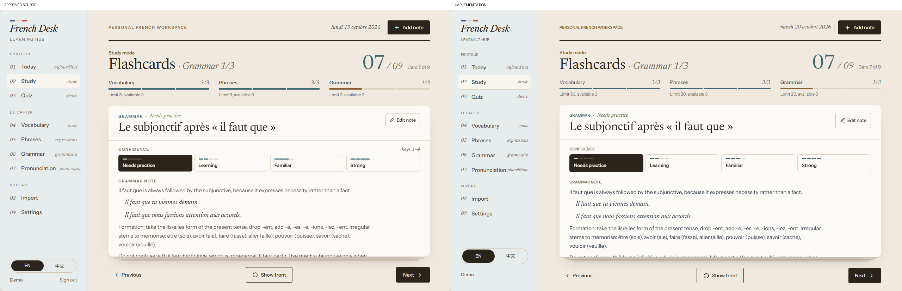
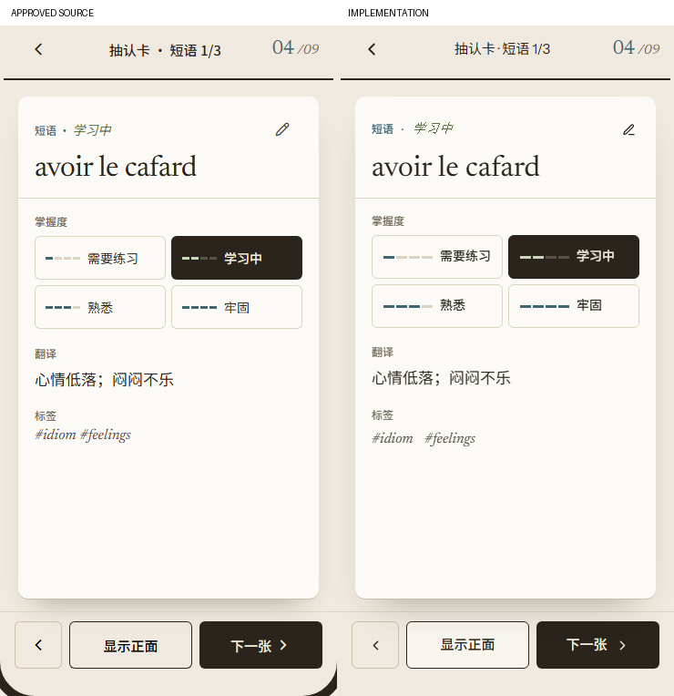

# UI 2.0 Phase 2: Study / Flashcards

Implementation branch: `codex/ui2-study-flashcards`.
Base: `UI_2.0` at `0cab114224f3d87c5fdf62c61319f82219e23e7b` (Phase 1 merged via PR #19).

## Implementation

The approved Le Cahier / Bois Study design is implemented in the real application, not in the prototype runtime.

- `ReviewView` retains the existing per-category queue creation, exclusions, confidence eligibility, saved position/flipped state, completion and persistence callbacks. Its presentation now includes an editorial heading, card position, segmented category ledger, paper stack, completion ledger and empty state.
- `StudyCard` presents the French front and the clean-sheet back. It preserves translation, example, notes, IPA, gender/POS, conjugations, adjective forms, tags, sanitized grammar HTML and Edit note. Long front text, back headers and details can scroll without displacing the action controls.
- `study.css` uses the Phase 1 tokens and fonts. Flip is 600ms; lift peaks at 300ms; exit is 200ms and arrival is 320ms. Navigation is locked synchronously during exit, pending navigation is cancelled on unmount, and reduced motion uses immediate state changes without animation-dependent locks.
- Vocabulary confidence remains read-only in Study. Phrase/Grammar confidence uses the existing callback with accessible radio controls and keyboard support. No confidence persistence implementation was changed.
- Mobile Study hides the regular shell header and bottom tabs only while Study is active. Its back button returns to Today, restoring access to the rest of the app. The focused header, safe-area-aware 52px actions, horizontal swipe navigation and tap-to-reveal follow the approved phone layout. Vertical scrolling and pinch zoom remain available.
- Space flips when the Study area has focus; Left/Right move cards; 1-4 changes Phrase/Grammar confidence on the back. Radio arrows stay within the radio group rather than navigating cards. Hidden faces have boolean `inert` and `aria-hidden`; focus leaves a face before it becomes inert. The old React `inert=""` warning is resolved. Progress and completion have live status announcements.
- `App.jsx` adds only a Study exit callback and a scoped presentation class. `AppHeader` omits the redundant Study page heading. Today, Quiz and the remaining modules retain their Phase 1 presentation.

No hooks, API/service modules, learning utilities, auth, database/schema, dependencies or deployment settings were changed. The approved HTML/support runtime was not imported into the application or added to its production bundle.

## Visual Comparisons

Visual authority: `Stage 2 - II Study.dc.html`, with the shared System and
Components references. The [final desktop overview](ui2-final/design-comparison-1.jpg)
includes Study's front. Two distinct reading examples are retained:

Source is left and implementation right, DPR 1. Desktop is 1280 x 800;
mobile content is 370 x 736, excluding the prototype bezel/status bar. Queue
order, configured limits and available records remain real; matching visual
fixtures do not change the randomized queue algorithm.

Repeated front/completion/header crops and raw observations were consolidated
into the final overview. Their history remains available at cleanup baseline
`2e9f111`. Review corrected vertical alignment, progress/action spacing,
confidence geometry, short-viewport overflow and long-note emphasis/indentation.
These are historical checks, not a new device or live-backend certification.

## Fidelity Notes

- Approved paper/sheet/river/wood/sage colors, 10px card corners, 72/58/46px desktop and 44/36px mobile French type steps, 44px desktop actions and 52px mobile actions are used. Study header spacing is scoped so Today is unchanged.
- Letter spacing remains normal, consistent with Phase 1. The prototype's expanded metadata and negative title tracking are not reproduced; this can change the exact completion-title line break while retaining the approved hierarchy and proportions.
- The existing self-hosted Newsreader/Instrument Sans and external Chinese font fallbacks are retained. Restricted font networks may produce different Chinese typography. No new font dependency was added.
- Prototype instruction captions (for example, click/keyboard hints and confidence explanations) are omitted from the visible card. Actions remain explicitly labeled and keyboard accessible. The front is an actual button, not a static illustration.
- Persisted note meanings are shown as stored, not automatically translated when the interface language changes. The Chinese phrase comparison uses a Chinese translation fixture. Production Demo notes and data are unchanged.
- Loading/error/retry states continue to use the existing readiness boundary. No fake loading scenario, resume toast, sample counts or completion is invented by the view.
- The completion capture has one unseen note added through the real Demo editor after the cycle was formed, so its new-cycle action is genuinely available. Exhausted cycles instead disable it and explain the next step. Tests cover both outcomes.

## Verification

Four focused Playwright tests cover flip/hidden faces/focus, keyboard and rapid navigation, detailed content and confidence radios, editor access, completion and a new unseen-only cycle, long-content scrolling, mobile gestures/exit/restoration, bilingual responsive controls and reduced motion. The existing Today completion test now waits for the new exit transition between cards. Existing refresh, hydration, account ownership, day rollover and persisted session tests remain in place.

| Command | Result |
| --- | --- |
| `npm run lint` | Passed |
| `npm run test` | 114 passed |
| `npm run build` | Passed |
| `npm run check` | Passed (lint, unit tests, build) |
| `npm run test:e2e -- --workers=4` | 138 passed |
| `git diff --check` | Passed |

The existing >500 kB bundle warning remains: production JS is about 767.13 kB / 221.57 kB gzip. This task does not split the bundle.

An earlier full run reused an old Vite process despite an attempted restart; seven exact-module-URL uncancellable-AI fixtures then missed HMR imports and timed out. After verifying and restarting the actual listener, all 138 tests passed without changing Editor/AI code or those fixtures.

Verification uses Chromium, mocked authenticated backends and disposable Demo data, not production accounts or paid AI calls. Physical iOS/Safari gesture and safe-area behavior has not been tested. GitHub CI, live production behavior and product approval are separate review gates. No database changes, deployment, PR creation or merge was performed.
