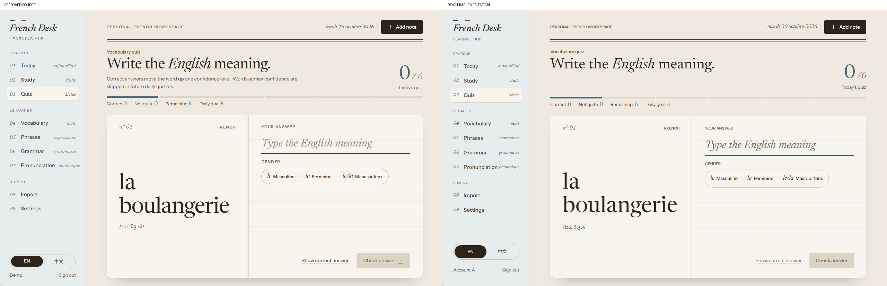
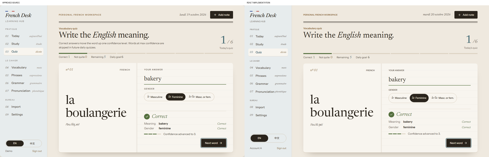
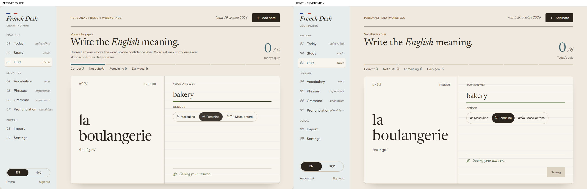
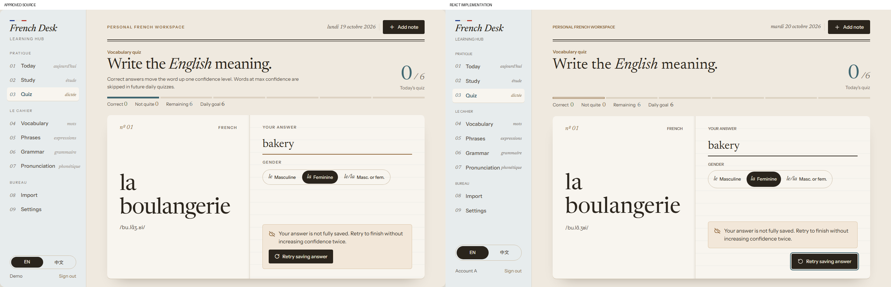
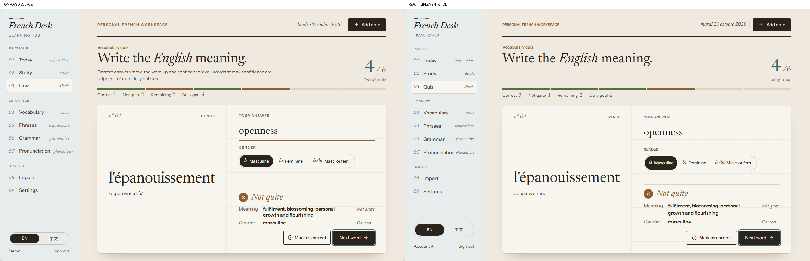
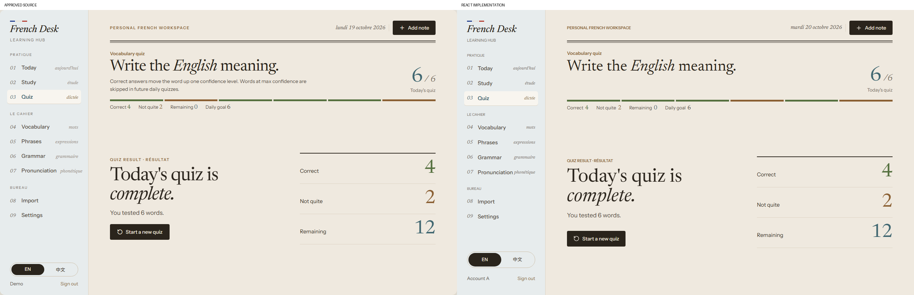
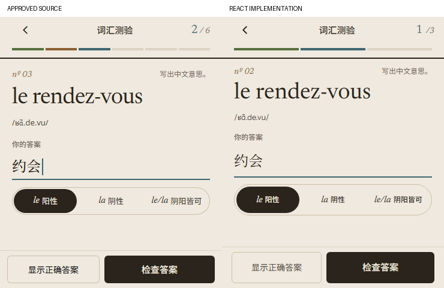
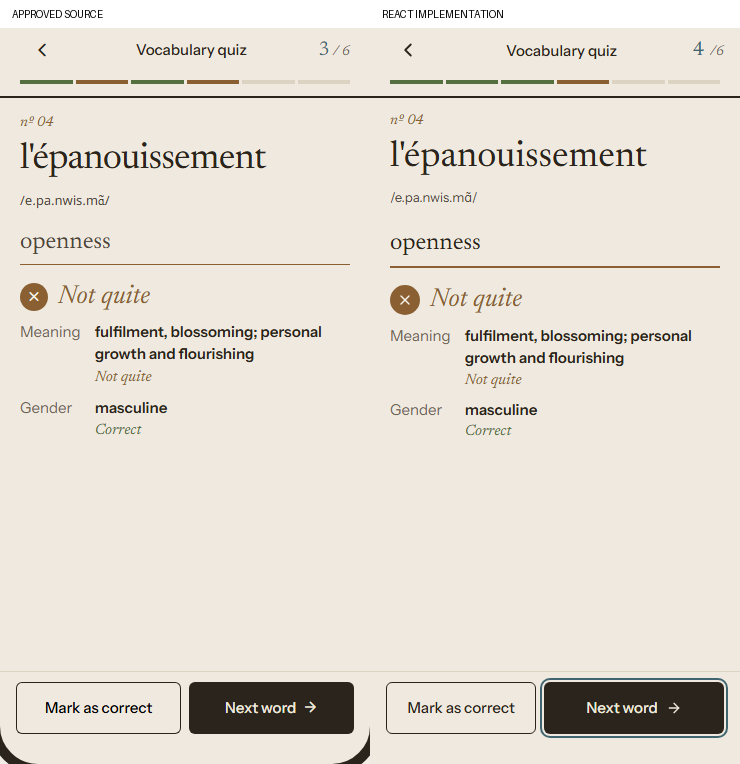
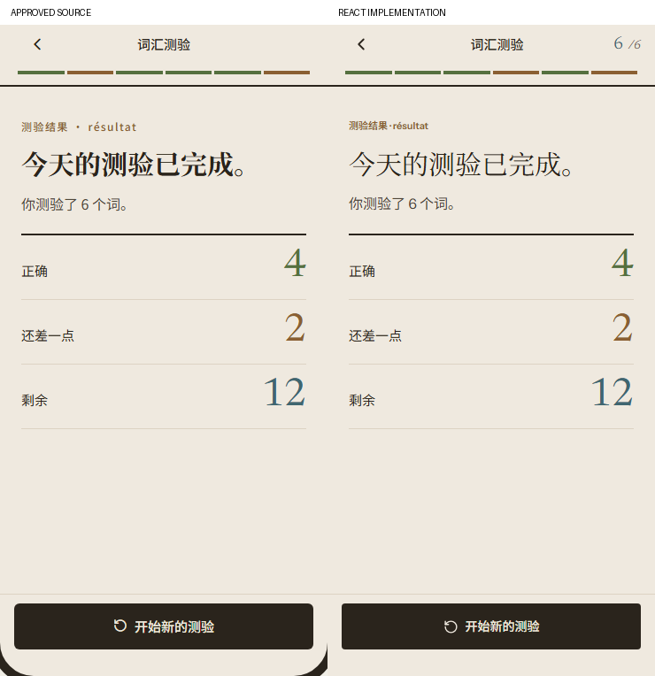

# UI 2.0 Phase 3: Quiz Experience

Implementation branch: `codex/ui2-quiz-experience`.
Base: `UI_2.0` at `fa89109a736da8ec1b1e4b9b223a784643f56c38` (Phases 1 and 2 merged).

## Implementation

The approved Le Cahier / Bois Quiz is implemented in the real React application. The prototype runtime is not imported or included in the production bundle.

- `QuizExperience` owns presentation, keyboard focus, visible-viewport sizing and cancellable question transitions. `QuizView` retains its existing state machine and handlers. A source comparison confirms its state, effects and functions, from `quizLimit` through `startNewQuiz`, are unchanged.
- The desktop notebook has an editorial heading, answered count, segmented progress, four-part ledger, French prompt, writing-line input, noun gender pills, feedback and completion ledger. Long prompts and translations wrap or scroll without displacing actions.
- Question direction remains French to the stored English/Chinese meaning. The three gender pills are native radios with full-option hit targets, native arrow-key behavior and visible focus. No selection leaves Check disabled for nouns requiring gender.
- Correct, incorrect, revealed, manually corrected, saving, failed/retry, completed, empty and exhausted states call the original handlers. The display withholds an unacknowledged final answer from its successful totals. Confidence feedback appears only after the existing save sequence acknowledges success.
- Focus starts on the answer, moves to Next after feedback, Retry after failure, and the heading on completion. Enter submits or continues through the focused control. Animation never initiates persistence. Navigation locks immediately and cancels on unmount; reduced motion continues immediately.
- Writing focus is 160ms; line color 300ms; feedback 240ms from 6px; confidence 420ms after 260ms; saving ink 1000ms then holds; next exit 180ms / arrival 300ms; completion 360ms. Reduced motion removes those animations.
- Mobile hides only Quiz's ordinary shell header and bottom tabs. Back returns to Today. `visualViewport` resize/scroll events size the actual visible area at normal zoom, with cleanup and a browser-height fallback. The writing region scrolls, actions stay in their own flow row, safe areas remain supported, and no fake keyboard or fixed keyboard height is rendered.
- `App.jsx` adds a Quiz exit callback and scoped class; `AppHeader` omits its redundant page title. New labels have English fallbacks and Simplified Chinese translations.

No learning utilities, hooks, API/service modules, authentication, database/schema, deployment configuration, dependencies, Today presentation or Study presentation changed.

## Visual Evidence

Source: `Stage 2 - III Quiz.dc.html`, checked alongside System, Components and Study references. Each combined image places the approved source left and React implementation right. Screenshots use DPR 1 and are not resized in the comparison files.

Desktop content regions are 1280 x 800; prototype canvas controls are excluded.

Mobile content is 370 x 736, excluding the source phone's bezel and simulated status bar. The keyboard comparison uses the source's 370 x 452 application region, excluding its illustrated keyboard. Chromium's visible viewport is simulated at the same height in the implementation test, not hard-coded in app CSS.

Additional actual states: [mobile question](ui2-phase3/mobile-question-chinese.png), [Chinese correct feedback](ui2-phase3/mobile-correct-chinese.png), [mobile saving](ui2-phase3/mobile-saving.png), [mobile retry](ui2-phase3/mobile-error.png), [desktop Chinese completion](ui2-phase3/desktop-complete-chinese.png).

Visual review corrected result-page label spacing on mobile, the desktop long-word size boundary, full-pill pointer targets and the keyboard-visible composition. Combined images were opened and reviewed after the corrections.

## Fidelity Notes

- Existing Phase 1 fonts, paper/sheet/river/wood/sage tokens, desktop shell, double rule and notebook proportions are retained. Tracking stays normal rather than copying expanded metadata or negative title spacing. The long-word step is 46px instead of 48px so the reference word fits without isolating its final letter; mobile remains 38/36px.
- Prototype feature explanations and shortcut badges are omitted from visible UI. Controls, native keyboard behavior and accessible labels remain. Desktop heading space is retained to align the notebook and ledger.
- The implementation uses actual counts, stored meanings, configured limit, current date, authenticated identity and unseen availability. The six-question visual fixture uses the same words as the source through mocked HTTP responses and the real hooks. It finishes with four correct/two incorrect and twelve real unseen records. Question histories can differ from the prototype's static phone samples; no production queues or sample data were changed.
- A failed save remains on the same word with its draft and gender intact. Retry is a persistent footer action rather than placed inside the alert. Saving similarly retains a disabled footer action. These keep mobile actions stable and all success indicators behind persistence acknowledgement.
- 44px desktop and 52px mobile action targets, visible focus outlines, native gender radios and translated labels can differ slightly from the illustrated control geometry. Device bezels, rounded screen corners, fake keyboard, tutorial annotations and prototype-only scenario controls are not recreated.
- Chinese fonts retain the existing network/fallback behavior. Stored English meanings do not automatically translate when switching interface language.

## Verification

Three focused Playwright tests reuse the existing authenticated backend fixture rather than a second Quiz implementation. They verify keyboard submission/continuation, native radio arrows and pointer selection, pending controls/totals, failed-save draft/focus, fixed-target retry, manual correction, reveal without confidence writes, persisted completion, genuinely unseen new-cycle questions, Chinese labels, 320/768/1440 widths, visible-keyboard action bounds, reduced motion and back/revisit restoration. The maximum configured 200-question ledger is also checked at 320px; dense ledgers use 1px mobile gaps so every segment remains inside the viewport. The existing final-write-failure test now also checks unconfirmed counts, Retry focus and retained input. Old styling selectors use a stable question test ID; Demo gender interaction uses the new native radios.

Existing regressions cover pending refresh recovery, no duplicate confidence increases, category changes, saved queues, account switching, Demo isolation, daily rollover, failed hydration and concurrent persistence. The demo was also exercised in the in-app browser, including incorrect feedback and manual correction.

| Command | Result |
| --- | --- |
| `npm run lint` | Passed |
| `npm run test` | 114 passed |
| `npm run build` | Passed |
| `npm run check` | Passed (lint, unit tests, build) |
| `npm run test:e2e -- --workers=2 --retries=1` | 141 passed on first attempt; no retries used |
| `git diff --check` | Passed |

The existing >500 kB bundle warning remains: production JS is 773.37 kB / 223.73 kB gzip. Bundle splitting is outside this task.

Earlier local runs intermittently hit `net::ERR_NO_BUFFER_SPACE`: once opening localhost in an existing import test, and once downloading an existing `fonts.gstatic.com` Noto Sans SC font in the Study console test (confirmed from its network trace). A complete 140-test rerun passed before the dense-ledger addition. The final 141-test run allowed one retry but passed every test on its first attempt. No assertions or protected application behavior were changed to hide these network failures.

All authenticated services in tests are mocked; no production accounts, databases or paid AI requests were used. Physical iOS/Safari keyboard, safe-area and assistive-technology behavior is not established by Chromium's viewport simulation. GitHub CI, production verification and product acceptance remain separate gates. No deployment, PR creation or merge was performed.
