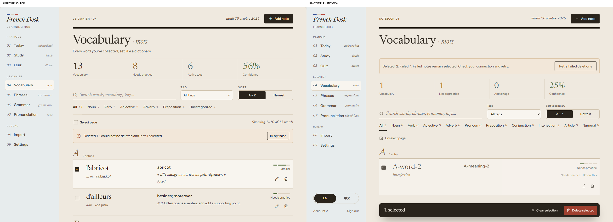

# UI 2.0 Phase 4: Content Library

Branch: `codex/ui2-content-library`.
Base: `UI_2.0` at `08305c36bfc55eb84b1fe1b0f0f494c2885c2131` (Phases 1-3 merged).

## Implementation

The four content libraries now use the approved Le Cahier / Bois visual system in the real React application. No Claude prototype runtime or new application dependency is included.

- Vocabulary uses ruled dictionary entries, accent-aware letter headings, a statistics ledger, writing-line search, native tag/sort controls, horizontally scrolling word-type counts, full morphology, contextual tags, confidence, edit/delete and ten-item pagination.
- Phrases use parallel French/translation columns on desktop, stacking below 900px. On phones the French and translation span the available content width; confidence and contextual actions follow below.
- Grammar has a local table of contents and one bright-sheet reader. Filtering/pagination resets the local reading selection; deletion falls back to a remaining visible note. Below 1024px, Contents opens a focused reader and Back returns focus to the selected contents button. Mobile retains the Phase 1 bottom navigation. Previous/Next stays within the existing page rather than adding routes or persistence.
- Pronunciation uses two-column rule fiches, becoming one column on mobile, with existing IPA, examples, notes and actions. No audio feature was added.
- `LibraryOverview` shares statistics/empty states. `NotesToolbar`, `PaginationControls`, `SelectionToolbar` and the small entry primitives in `LearningCard` share existing behavior without creating a generic UI framework. Mobile filters use native tag/sort radios in a bottom sheet. Mobile entry actions retain confidence controls as well as edit/select/delete.
- `LibraryDialog` uses the browser's modal dialog behavior for focus trapping, background inertness and Escape. It restores a connected, visible trigger on close. Note deletion now uses the designed confirmation, including selected titles and an irreversible-deletion warning. Confirmation remains single-flight and account-scoped; unmount cancels an unresolved decision.
- Existing job-wide deletion locks, pending feedback, partial-success reconciliation, failed selection and retry remain owned by `useNotes`. No backend deletion algorithm changed. A successful row is removed before another row's delayed response finishes.
- Hover, selection, filter/sort/page, sheet and reader transitions are CSS-only. Reduced motion removes their animations. Pending presentation does not delay or initiate mutations.
- New operational labels have English fallbacks and Simplified Chinese translations. The desktop header and library stylesheet are conditional on the four library sections.

## Preservation Boundaries

No changes were made to API routes, API wrappers, hooks, services, learning utilities, Auth, database/schema, deployment configuration, dependency manifests, Today/Study/Quiz presentation, Editor Modal, rich-text editor/sanitizer, Import or Settings views. The shared header retains its original non-library rendering path. Phrases and Pronunciation remain thin wrappers around `NotesView`.

Search remains the existing application-wide query, including meanings, tags, morphology and notes. Vocabulary keeps the original French `Intl.Collator` comparator and date-added fallback ordering, type counts and ten-item page size. Notes retain their existing ordering and page clamping. Selection and all mutations still use the original hooks and account ownership checks. Rich grammar HTML is rendered through the unchanged `RichTextContent` and sanitizer.

## Visual Evidence

Sources: `Stage 3 - V Vocabulary.dc.html` and `Stage 3 - VI Notes.dc.html`.
The retained [desktop overviews](../UI2_FINAL_AUDIT.md#visual-and-accessibility-review)
cover all four libraries; [English](ui2-final/mobile-en.jpg) and
[Chinese](ui2-final/mobile-zh.jpg) overviews retain the mobile presentation.

This source-left/React-right capture comes from the authenticated hooks with
mocked HTTP, not invented UI state. Its records intentionally differ from the
static example: two of three notes are deleted and the failed note stays selected.
Original page captures were 1280 x 900 at DPR 1; mobile content was 370 x 736
after excluding prototype phone chrome. Selection/action crops were component
views, not substitutes for full-page review.

Historical geometry checks covered 56 bilingual combinations at 320, 390, 768,
900, 1024, 1280 and 1440px, with no recorded document overflow, clipped measured
content or app console/page errors. Repetitive reader/filter/selection captures
and raw runtime records were consolidated; Git baseline `2e9f111` retains them.
Behavioral decisions, mutation tests and acceptance limits remain below.

## Fidelity Decisions

- French article handling intentionally follows the current application, not the prototype's article-stripping comparator. `l'abricot` remains under L and `d'ailleurs` under D. Headings fold accents and group OE/AE ligatures with O/A without modifying titles, search or sort order. Valid existing zero-count word-type options remain scrollable instead of disappearing.
- Existing statistics semantics remain: Vocabulary statistics follow the global query/tag subset, while the other sections' ledgers describe their category. Consequently, an empty Vocabulary search shows zero statistics, unlike the prototype's fixed whole-library sample ledger.
- All stored verb/adjective forms are retained on mobile rather than replacing them with the prototype's abbreviated sample. Full translated word types/genders remain understandable. Longer rows, phone selection controls and functional confidence controls add height compared with the compact static phones.
- The mobile bottom navigation is retained even in the grammar reader and selection mode. Its safe area remains separate from the fixed selection toolbar. The reader hides its list search/ledger until Back, but any existing selection remains actionable.
- Grammar content keeps the existing permitted HTML structure. Actual paragraph/list lengths, numbering and emphasis can differ from the prototype's hand-authored abbreviated blocks; no stored HTML is rewritten for visual similarity.
- Existing Add first note is retained for new accounts; Import remains reachable through the existing navigation rather than adding another cross-view callback. Empty-page zero ledgers and filters are hidden. Search/help copy uses existing bilingual strings; prototype feature explanations and fake scenario switches are omitted.
- Fonts, paper/sheet/sky/river/wood/sage tokens and supplied tricolour come from Phase 1. Tracking stays normal. Operational chapter labels are localized; mobile English category names can accompany Chinese glosses. Accessible names retain the full existing category name, including Pronunciation Rules.
- Native dialogs include a Close button, visible focus and cancel-on-Escape. Native hit targets, real tag counts, retained actions, current dates/identity and existing pagination semantics may differ from illustrative geometry. Mobile scenario examples and deletion fixtures do not pretend to have identical records: the partial-delete reference removes one of two words; the authenticated regression removes two of three and keeps the failed one selected.
- Minor retained shell/font limitations: the existing Newsreader faces declare weights 400-500, so bold can look lighter than the reference. The unchanged Phase 1 desktop sidebar's decorative pronunciation gloss can crowd its label when a short window adds an internal scrollbar. Neither the shared font assets nor non-library shell styling was changed in this phase.

## Verification

Four focused Playwright tests reuse the existing backend fixture. They cover search/IPA/tag/type matching; alphabetical/newest ordering; cross-page selection through empty filters; cancel/confirm; actual deletion IDs; accent/ligature grouping and legacy gender/forms without POS; grammar HTML and narrow confidence PATCHes; missing selected notes; Escape/focus/account cancellation; Chinese mobile filter radios; action sheets; confidence; reader Back; selection while reading; 320px pagination/scroll reset; bottom-navigation bounds and reduced motion.

Existing deletion tests continue to verify all success/failure, partial reconciliation and retry, duplicate clicks, account switching, pending Quiz/editor updates, lost responses and Demo-only mutations. Their selectors now use native checkboxes and the designed confirmation. Successful deletion also verifies the new-account Add first note path. The existing Demo CRUD test uses the same confirmation. No assertions were removed to hide backend failures.

| Command | Result |
| --- | --- |
| `npm run lint` | Passed |
| `npm run test` | 114 passed |
| `npm run build` | Passed |
| `npm run check` | Passed |
| `npm run test:e2e -- --workers=1 --retries=1` | 145 passed on first attempt; no retries used |
| `git diff --check` | Passed |

The existing bundle-size warning remains: JS 778.10 kB / 225.94 kB gzip. Bundle splitting is outside this task. Two-worker intermediate full runs passed with one retry each: Today viewport geometry once, and the Quiz saved-queue assertion once (an old queued ID was still present when inspected). Their causes were not established and are not attributed to fonts or network failures. The final single-worker run passed all 145 on their first attempt. No test assertions or protected application code were changed to suppress these results.

All authenticated services use mocked backend data; captures use disposable matching-content Demo fixtures. No production database or paid AI calls were used. Physical iOS/Safari, assistive technology, GitHub CI, live production behavior and product acceptance are separate gates. No deployment, PR creation or merge was performed.
