# UI 2.0 Phase 5: Editor Modal

Branch: `codex/ui2-editor-modal`.
Base: `UI_2.0` at `77a867fd77550ef0106d98c8cde6865b78d611d1` (Phases 1-4 merged).

## Implementation

The existing editor now uses the approved Le Cahier / Bois notebook presentation. It remains the real React form, not the prototype runtime.

- `EditorModal` has an 880px desktop sheet, fixed header/footer, independently scrolling body, native four-category radios, Roman section headings, French writing lines and conditional vocabulary morphology. Vocabulary uses two columns at desktop widths; narrower tablets stack its sections. Phrases retain full-width French/translation fields. Grammar retains its title and sanitized rich HTML. Pronunciation retains its explanation, examples, notes and an IPA input for the existing IPA property.
- Confidence and noun gender use native radio controls. Abbreviated morphology labels retain full accessible names. All existing 45 special characters remain reachable through the compact scrolling toolbar; insertion still replaces the French input's selected range and restores the cursor.
- Existing AI request identity, cancellation, account checks and manual-edit tracking are preserved. A separate, temporary sage wash only indicates changed fields; it cannot alter the authoritative merge. Status messages, explicit retry, quota explanations and disabled Demo AI remain real service states.
- Required-field messages and the existing backend validation/duplicate errors retain the draft. Pending Save disables and dims fields, preserves Close, announces the real operation and prevents duplicate writes through the existing App session lock. Failed Save offers Save again without changing its accessible Save note command. Successful Save uses the existing close behavior, not a fake delay or toast.
- The mobile sheet fills the browser's visible viewport. `visualViewport` resize/scroll events update height and top offset without re-rendering the form or guessing keyboard dimensions. The document is scroll-locked while the sheet is open; the body scrolls independently and safe-area-aware actions remain below it.
- The focus effect remains installed once. Tab wrapping excludes disabled-fieldset and inert descendants; Escape cancellation and trigger focus restoration remain intact. Rich-text commands, paste processing, sanitization and saved HTML are unchanged. Reduced motion disables editor transitions and animations.

## Preservation Boundaries

No changes to `App.jsx`, note hooks/mutations, API routes/wrappers, AI services, merge/validation/sanitization utilities, Auth, daily persistence, quota semantics, database/schema, deployment settings, dependency manifests, or other view designs. The rich editor and character keyboard gain scoped presentation hooks; `RichTextContent` is unchanged. No paid AI call or production database operation was used.

## Visual Evidence

Primary source: `FrenchLearning UI 2.0 directions/Stage 3 - VII Editor.dc.html`. Components IX, System IV and the Phase 4 library supply supporting typography, tokens and interaction conventions.

Combined images place the rendered source on the left and actual React interface on the right, at DPR 1 without resizing. Desktop page captures are 1280 x 900. Dialog detail captures retain their natural sizes; short forms may have different heights because the app retains all existing fields/characters and real content. The actual AI/Save captures come from mocked HTTP requests through the normal Auth, service, note hooks and App editor session.

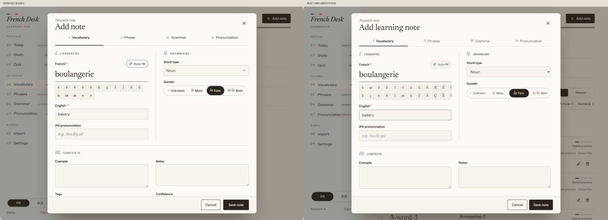
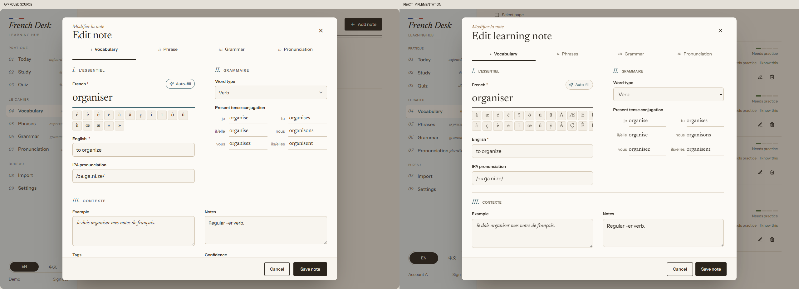
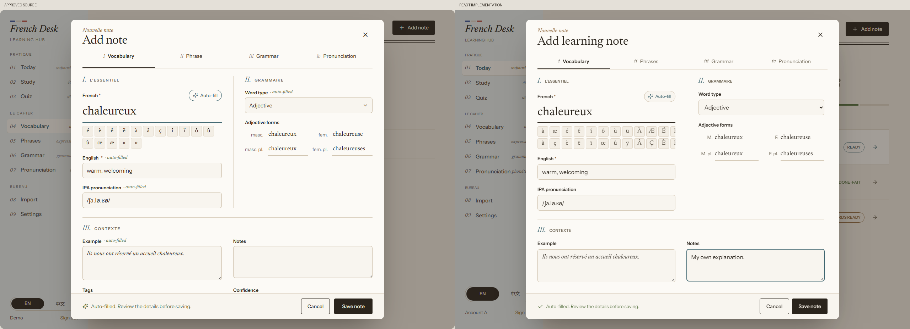
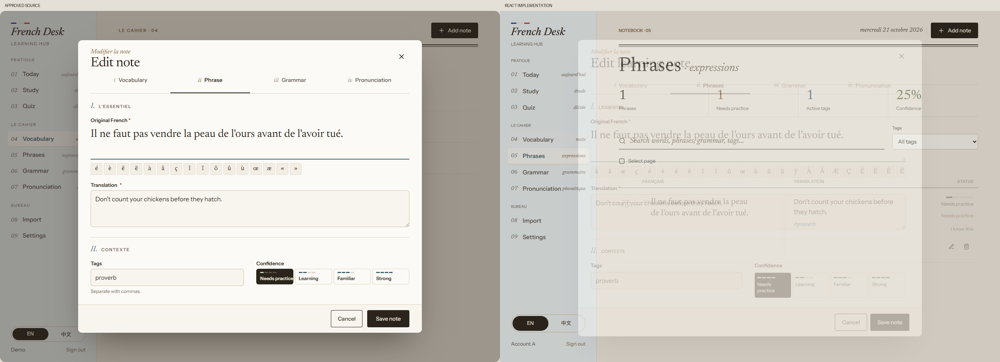
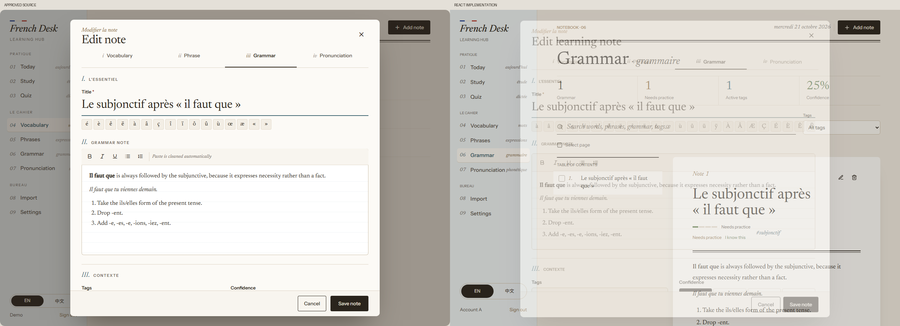
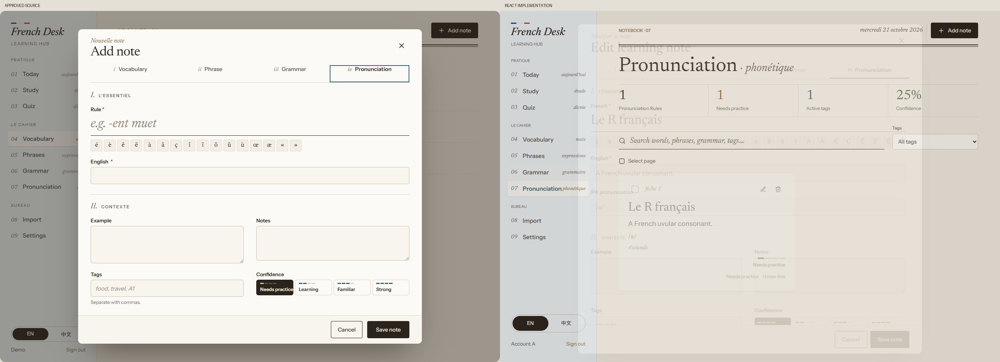

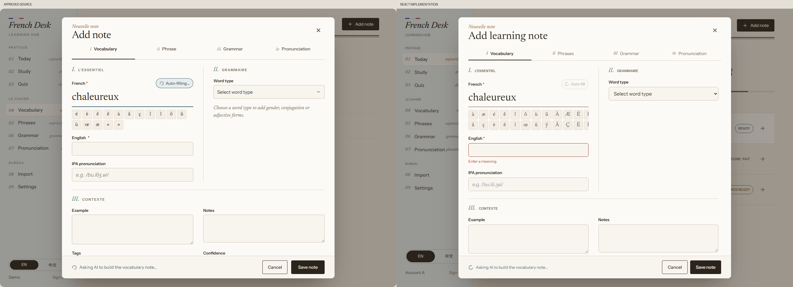
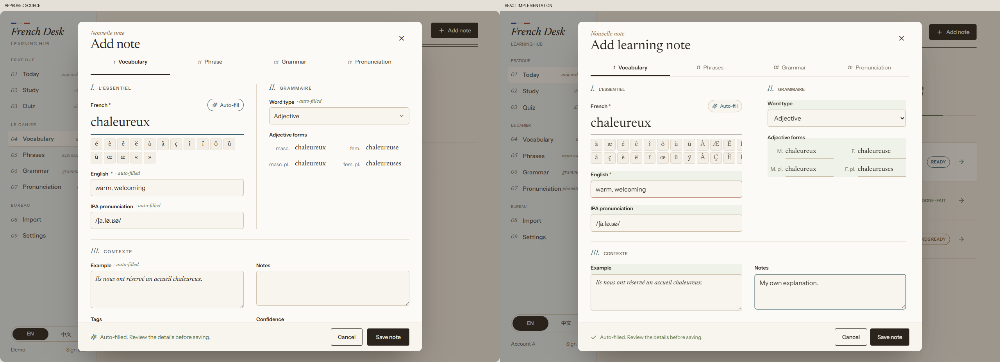
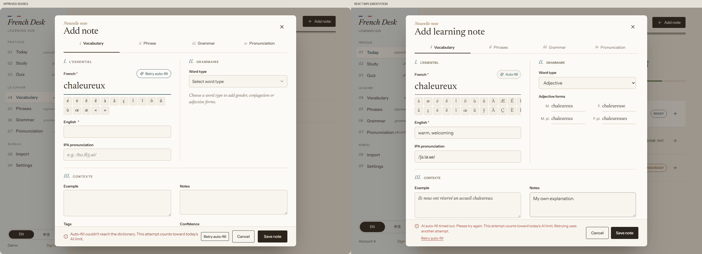
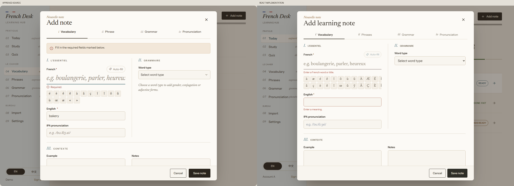
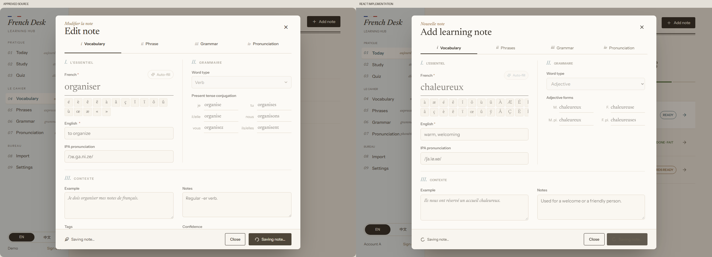
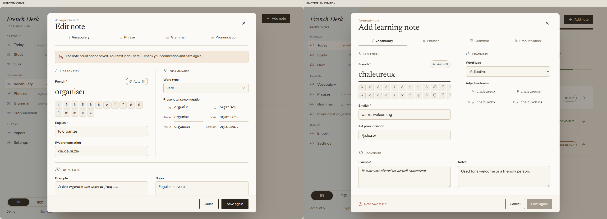

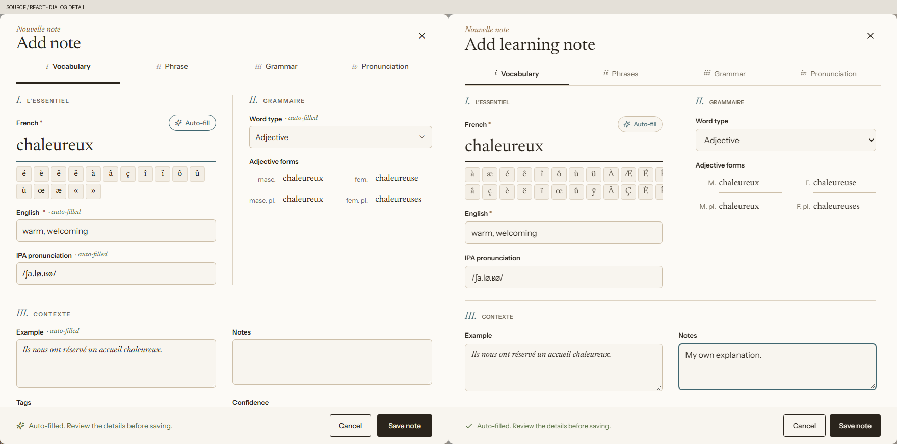
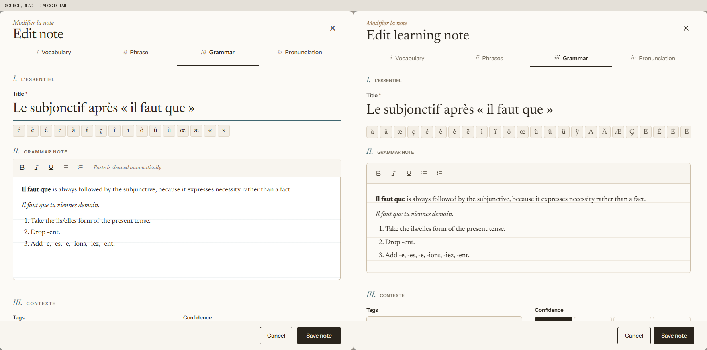

Mobile comparisons exclude the source phone's bezel, status bar and illustrated keyboard. The source phone's content area is 370 x 736. Its keyboard-open example leaves a measured 370 x 472 editing viewport; the regression emulates that browser-visible height, rather than drawing a keyboard. This is geometry verification, not a physical iOS/Android keyboard test.

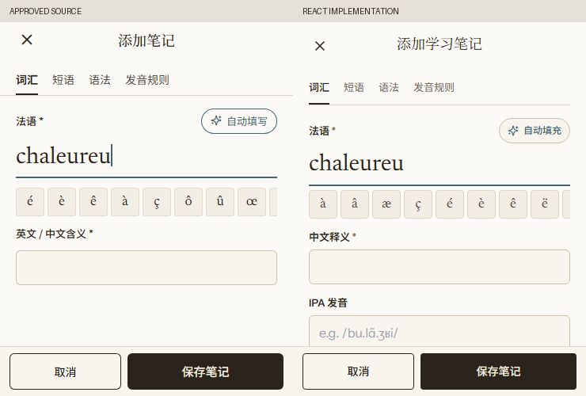
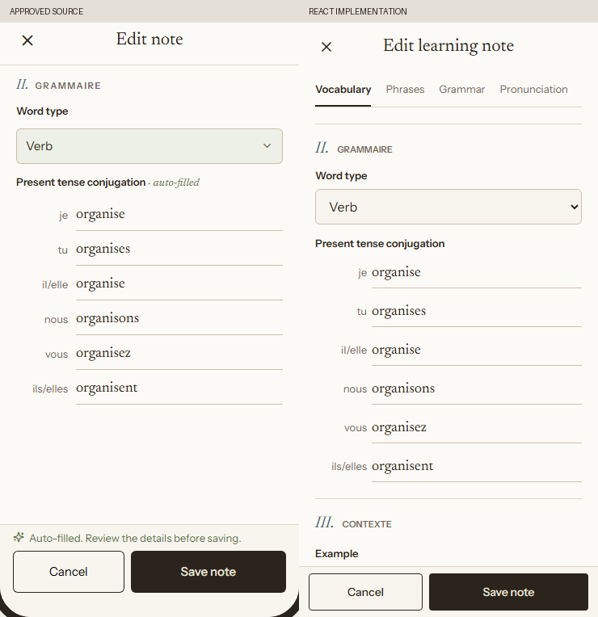
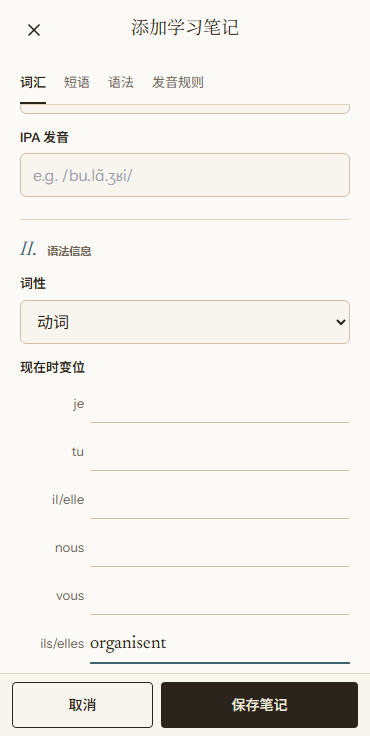

[Runtime measurements](ui2-phase5/runtime.json) cover all four categories in both languages at widths 320, 370, 390, 768, 900, 1280 and 1440. All 56 combinations have no measured document/dialog overflow or clipped category, confidence, gender or field-heading text. Capture contexts recorded no console/page errors or backend/AI requests.

## Fidelity Decisions

- Existing dialog names remain Add learning note / Edit learning note, including translated equivalents. Categories retain their full accessible names, including Phrases and Pronunciation Rules; the visible Pronunciation label is shortened to avoid awkward phone wrapping. Real explanatory content and validation/error messages are retained.
- The toolbar retains all 45 existing characters rather than only the prototype's 16. It scrolls horizontally, with compact desktop rows and a single phone row. Retained character availability and full translated labels can change form height.
- Confidence labels may wrap on narrow cards rather than overflow as in the abbreviated prototype. Native radios/selects retain keyboard behavior. Tracking is normal, not the prototype's negative or expanded letter spacing.
- AI highlights are temporary and apply only to actually changed values. No persistent AI provenance is invented. The success capture also includes a deliberately preserved manual note; the source success example has an empty Notes field. AI failures use the actual safe upstream message and quota notice, not the prototype's simulated dictionary error.
- Save errors remain visible in the persistent footer with the real backend message and Save again action. The prototype puts a longer illustrative error above its fields. No new error translation or backend contract was invented for visual matching. Pending fields and the real operation are announced; success closes the current editor immediately as before.
- Rich HTML uses the existing sanitizer and commands. The formatting tools remain real, with tooltips and semantic names; the prototype's visible instructional captions are omitted. No stored content is rewritten to fit a screenshot.
- Typography uses the existing locally hosted Newsreader/Instrument Sans and existing Chinese fallbacks. Minor optical differences from the reference's externally hosted fonts remain. No fonts or other page styles were changed.
- Entry/scrim, focus and AI feedback follow the motion tokens. Closing remains immediate to preserve cancellation/session semantics rather than delaying an asynchronous close for the prototype's illustrative exit animation.

## Verification

State/content differences are explicit rather than hidden by pixel matching: the source Pronunciation example is empty while the real capture edits a saved IPA note; source Save pending/failure uses a verb while the real capture saves the preceding AI-filled adjective; the source validation scenario has only French missing, while the real flow validates both required fields. The mobile source verb illustration includes an AI-success annotation, while the Demo morphology capture correctly has no invented AI provenance. The extra real category controls remain available on mobile. These are comparisons of the corresponding layout/status surfaces, not claims of identical fixtures.

Three focused Playwright tests reuse the existing account/backend fixture. They verify all-category create/edit and actual persisted records, conditional noun/verb/adjective fields, character selection replacement, rich formatting, native validation recovery, real AI loading/success/failure/manual retry, retained manual edits, transient highlights, real pending/failure/retry Save states, the reduced mobile viewport, long scrolling, 320px/tablet bounds, focus wrapping/restoration and reduced motion.

Existing editor, Demo and reliability tests retain their assertions, with category/confidence selectors updated for native radios. They continue covering uncancellable stale responses, word/category/language changes, account switches, same-account editor replacement, duplicate Save, late saves, failed Save/retry, quota errors, rich paste/Save/Reload/Edit, duplicates and cross-feature note consistency.

| Command | Result |
| --- | --- |
| `npm run lint` | Passed |
| `npm run test` | 114 passed |
| `npm run build` | Passed |
| `npm run check` | Passed |
| `npm run test:e2e -- --workers=1 --retries=0` | 148 passed |
| `git diff --cached --check` | Passed |

The final complete Playwright run passed every test on its first attempt, without retries. The preceding complete run also passed; an intermediate rerun was deliberately stopped for the final mobile-strip presentation correction, not reported as a pass. Early focused checks exposed label-locator and stale validation-message issues, which were corrected and covered by the final suite. No test assertions were removed to suppress failures.

The production build retains the existing bundle-size warning: JS 783.08 kB / 227.23 kB gzip. Source/implementation comparisons were re-opened after the layout and selected-state corrections. Visual QA found no remaining actionable P0/P1/P2 editor mismatch; accepted functional/content differences and external acceptance gates are listed above and below. Protected-path diff inspection found no changes in API, hooks, services, utilities, App orchestration, views, schema or dependency manifests.

Remaining external gates: physical mobile keyboards/Safari, assistive technology, GitHub CI and product acceptance. The pre-existing main-bundle size warning is outside this phase. No PR creation, merge or deployment is part of this delivery.
